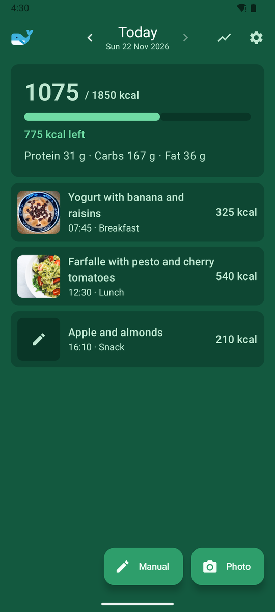
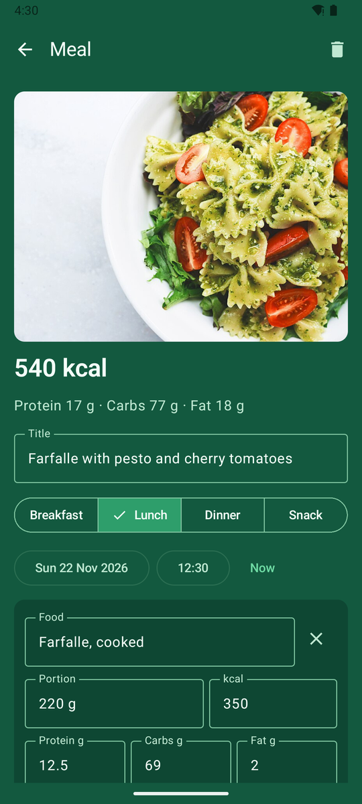
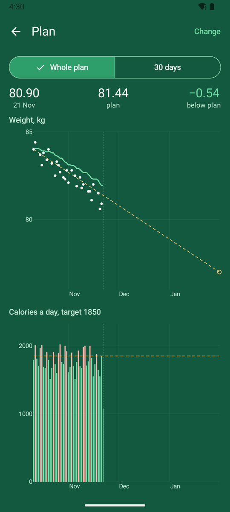

# Michelle

Take a photo of your meal; Claude says what's on the plate and how many calories (and protein, carbs, fat)
it is. Fix what it got wrong, save, and the meal is kept on the phone and written to Health Connect, so
your other health apps see it. The home screen shows today's meals and the day's total.

For one person on a Pixel 10 (Android 16), installed over USB. Uses your own Anthropic API key.

<p>
  
  
  
</p>

## Build and run

Needs the Android SDK in `~/Android/Sdk` (platform 36, build-tools 36.1.0) and JDK 21. A phone with USB debugging on, then:

```
./gradlew assembleDebug
adb install -r app/build/outputs/apk/debug/app-debug.apk   # -r keeps your meals
adb shell am start -n dev.michelle/.MainActivity
./gradlew testDebugUnitTest                                 # the unit tests
```

Never uninstall it or clear its data on a phone you use: that deletes your meals and photos.

Or with [just](https://github.com/casey/just): `just test`, `just install` (backs up the phone's data
into `.backup/` first, then `adb install -r`), `just run`, `just log`, `just key`, `just backup`,
`just restore .backup/michelle-….tar` (asks first), `just analyze food.jpg`; `just` lists them.

## The API key

Michelle needs an Anthropic API key (console.anthropic.com → API Keys). Put it in
`.secrets/anthropic_api_key` (not in git; the key alone or `ANTHROPIC_API_KEY=sk-ant-...`), unlock the
phone and run:

```
tools/set-key.sh               # or: tools/set-key.sh --clipboard, or without the file it asks
```

It opens Michelle's settings with the key field focused, types the key and saves it. The key is kept
encrypted with a key from the Android Keystore; it's never logged. It can also be typed in settings.

## Using it

- **Photo** or **Manual** (bottom right; Manual: describe it in words and let Claude estimate, or type the numbers yourself): the Pixel camera opens; take the picture and confirm. Claude needs a few
  seconds (about 6 s with Opus 5.5).
- Check the items: change any food, portion, kcal or grams, remove items (×), add one. The title, the
  meal type (guessed from the time) and the time can be changed too. **Save**, or ✕ to discard.
- No food in the photo, or no network: retake, retry, type it in by hand or discard.
- Tap a meal on Today to change or delete it; Health Connect follows.
- Settings (gear): the key, the model (Opus 5.5 by default, about 2–4 cents a meal; Sonnet 5.5; Haiku
  5.5, a fraction of a cent), Health Connect permission and "sync now".

## Goal and plan

Plan (chart icon) → Goal (Change): start date and weight (default today and your latest weight in Health
Connect), target date and weight. Once, the profile: sex, birth
date, height (from Health Connect if it's there) and activity level. The daily calorie target is worked
out from them: Mifflin-St Jeor × activity for your current weight, minus what it takes to reach the
target by the date (7700 kcal a kg), never below 1500 (men) / 1200 (women): if the plan needs less,
Michelle says it's too fast. On saving it asks to read your weight and height from Health Connect.

Weigh yourself in Google Health as before: Michelle only reads weights. Today then shows "of 1750 · 450
left" (or over); the chart icon opens the Plan screen:
weights, the smoothed trend, the plan line to the target, and calories a day against the target, for
the whole plan or the last 30 days. Calories eaten are Michelle's meals only.

Health Connect: Michelle asks once, after the first save, for permission to write nutrition (nothing
else, it never reads). A meal that couldn't be written shows a small cloud icon and is written the next
time Michelle opens, or with "sync now".

## Release build

`./gradlew assembleRelease` makes `app/build/outputs/apk/release/`, signed with the key in the file
named by `MICHELLE_KEYSTORE` (with `MICHELLE_KEYSTORE_PASSWORD`, `MICHELLE_KEY_ALIAS`) in
`~/.gradle/gradle.properties`, outside the repo; without them it comes out unsigned. A release build
can't replace a debug build (different signatures) without uninstalling, which deletes the meals, so
stay on one kind.

## Checking an analysis without the camera (debug builds)

```
adb push food.jpg /data/local/tmp/ && adb shell chmod 644 /data/local/tmp/food.jpg
adb shell run-as dev.michelle sh -c "'mkdir -p cache/capture && cp /data/local/tmp/food.jpg cache/capture/t.jpg'"
adb shell am start -n dev.michelle/.MainActivity --es photo /data/user/0/dev.michelle/cache/capture/t.jpg
adb logcat -s michelle     # timing and Claude's JSON
```

Delete the test meal afterwards (open it → trash).

## Screenshots

The pictures above come from an emulator with made-up meals and weights, never from a phone in use:
start one (`android emulator create medium_phone && android emulator start medium_phone`), then
`just screenshots`. It builds a separate demo app (`-Pdemo`: `dev.michelle.demo`, with
`app/src/demo/`, which seeds the data), installs it on the emulator and saves `docs/*.png`. The food
photos are CC0, from Wikimedia Commons.

## Layout

```
tools/set-key.sh            the API key onto the phone
tools/screenshots.sh        the README screenshots, from an emulator (made-up data)
app/src/main/java/dev/michelle/
  App.kt                    the app's parts; syncs Health Connect on start
  MainActivity.kt           the screens (Today, Meal, Settings) and the camera
  Meals.kt                  save/delete: the database first, Health Connect after
  Secrets.kt, Settings.kt   the API key (Keystore-encrypted), the model
  ai/Analyzer.kt            Claude: the photo in, JSON out (structured output), errors
  ai/Prompt.kt, Analysis.kt what Claude is asked, the JSON schema, parsing
  Goal.kt                   the goal (plan line, pace) and the profile; kept in the app's preferences
  trend/                    the numbers: daily kcal, smoothed trend, calorie target; Progress loads them
  health/BodyReader.kt      Health Connect, reading: weights, height
  data/                     Room: meals, items, Health Connect deletes still to do; meal types; totals
  photo/Photos.kt           camera file, upright, 1600 px JPEG in the app's files
  health/HealthWriter.kt    Health Connect: a meal = one NutritionRecord ("meal-<id>")
  ui/                       Compose screens, charts (Canvas), goal settings, theme (greens), photos
```

## License

MIT, see [LICENSE](LICENSE). The camera, chart, cloud-off and edit icons are
[Material icons](https://fonts.google.com/icons) by Google (Apache 2.0); the whale is Michelle's own.
